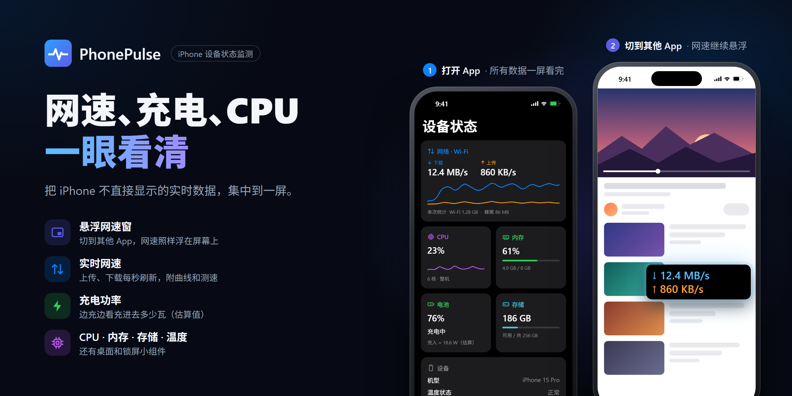

# PhonePulse（暂定名）



iPhone 设备状态监测 App：实时网速、充电功率（估算）、CPU、内存、存储、温度状态，一屏看完。

## 先说清楚：iOS 能做什么、不能做什么

iOS 沙盒很严格，安卓上理所当然的功能在 iPhone 上要么做不了，要么只能变通。产品设计和宣传都要以此为准，否则会被审核拒绝，或被用户差评。

### 数据可行性

| 指标 | 能否做到 | 实现方式 | 备注 |
|---|---|---|---|
| 实时网速（上/下行） | ✅ App 在前台时 | `getifaddrs` 读网卡累计字节，每秒求差 | 退到后台后系统会暂停 App，无法持续采样 |
| 主动测速 | ✅ | URLSession 下载/上传计时 | 需要自建测速节点 |
| 网络类型 | ✅ | `NWPathMonitor` | Wi-Fi / 蜂窝 / 有线 |
| CPU 占用 | ⚠️ 需真机验证 | `host_statistics(HOST_CPU_LOAD_INFO)` | 若被沙盒限制，自动退化为"仅本 App" |
| 内存 | ✅ | `host_statistics64` + `task_info` | |
| 电量 / 充电状态 / 低电量模式 | ✅ | `UIDevice` / `ProcessInfo` | |
| 充电功率 | ⚠️ 只能估算 | 电量变化速度 × 电池容量 × 3.85V | 没有公开的电流/电压 API；需采样几分钟；界面必须标"估算" |
| 电池健康 / 循环次数 | ❌ App 内做不到 | 只有私有 API | 可考虑做电脑端 USB 读取作为增值方案 |
| 存储空间 | ✅ | `URLResourceValues` | |
| 温度 | ⚠️ 只有档位 | `ProcessInfo.thermalState` | 正常/偏高/高/严重 4 档，没有摄氏度 |

### 显示位置

| 方式 | 实时性 | 状态 |
|---|---|---|
| App 内仪表盘 | 每秒刷新 | ✅ 已搭好 |
| 桌面 / 锁屏小组件 | 由系统调度，约 15 分钟以上一次 | ✅ 已搭好，显示上次打开 App 时的数据 |
| 灵动岛 / 实时活动 | App 在前台时可实时更新，后台基本不行 | Phase 2 |
| 画中画悬浮窗 | 每秒刷新，最接近安卓的悬浮网速 | 🧪 原型已写好，待真机验证；审核有风险，国区已有同类上架 |
| 修改系统状态栏 | ❌ | iOS 不允许 |

> 结论：App 内仪表盘 + 小组件是稳妥的基本盘；真正能对标"安卓状态栏网速"的是**画中画悬浮窗**，它是差异化卖点，也是审核风险点，Phase 2 先做原型验证。
> 国区 App Store 已有不少同类产品（搜"网速""悬浮窗""电池"），要靠体验和悬浮窗做出差异。

## 项目结构

```
project.yml              XcodeGen 工程描述（.xcodeproj 由它生成，不入库）
App/                     主 App
  PhonePulseApp.swift    入口：前台开始采样、后台停止
  Metrics/               各项指标采集 + 调度中心 MetricsEngine
  SpeedTest/             主动测速
  FloatingWindow/        画中画悬浮网速窗
  Diagnostics/           真机诊断页 + 事件日志
  Views/                 SwiftUI 界面
  PrivacyInfo.xcprivacy  隐私清单
Core/                    纯计算逻辑（网速增量、CPU 占用、功率估算），不碰系统 API，有单元测试
Shared/                  App 与小组件共用：数据模型、App Group 存储、格式化
Widget/                  桌面 / 锁屏小组件
Tests/                   Core 和 Shared 的单元测试
.github/workflows/       云端 macOS 编译 + 测试
docs/                    封面图：cover.html 是源文件，cover.png 由它导出
```

数据流：`各 Monitor` → `MetricsEngine`（每秒采样，保留 60 秒曲线）→ 界面；同时每 30 秒和退到后台时把快照写进 App Group → 小组件读取。

## 悬浮网速窗（画中画）

iOS 不允许 App 在别的 App 上面画东西，但允许"画中画播放视频"。做法是：

1. `MetricsEngine` 每秒采样后通过 `onTick` 通知 `FloatingSpeedController`
2. `SpeedFrameRenderer` 把网速画成一帧图像（CVPixelBuffer → CMSampleBuffer）
3. 这一帧送进 `AVSampleBufferDisplayLayer`，再由 `AVPictureInPictureController` 用画中画显示
4. 画中画开着时系统让 App 在后台继续运行，所以采样和刷新不会停

前提条件：
- Info.plist 声明 `UIBackgroundModes = audio`（"音频、AirPlay 和画中画"后台模式），已在 `project.yml` 里配置好
- 音频会话设为 `playback` + `mixWithOthers`，不会打断用户正在听的音乐
- 视频源图层必须显示在界面上，所以仪表盘里有一块预览卡片

**真机验证清单**（模拟器上画中画行为和真机不一样）：
- [ ] 点"开启悬浮窗"能弹出悬浮窗
- [ ] 切到其他 App，悬浮窗里的网速每秒刷新（比如边看视频边观察）
- [ ] 留在仪表盘时直接上滑回桌面，悬浮窗自动弹出（需在 设置 → 通用 → 画中画 打开"自动开启画中画"）
- [ ] 关闭悬浮窗后 App 能正常停止采样，不再后台耗电
- [ ] 开着悬浮窗 30 分钟，在 设置 → 电池 看耗电是否可以接受
- [ ] 用手机放音乐时开启悬浮窗，音乐不被打断

**已知限制**：画中画上会有系统自带的播放/暂停按钮（没有公开 API 能隐藏），点了也没影响；悬浮窗大小和位置由系统控制。

## 验证分三层

| 层次 | 能证明什么 | 不能证明什么 | 怎么做 |
|---|---|---|---|
| 云端编译 | 代码没有语法/类型错误，App 和小组件都打包出来了，Info.plist 与隐私清单生效 | 任何运行时行为 | GitHub Actions 自动执行 |
| 单元测试 | 网速增量（含回绕、接口重置）、CPU 占用、功率估算、格式化的计算正确 | 系统 API 在真机上能否读到数据、悬浮窗行为 | GitHub Actions 在模拟器上自动执行 |
| 真机验证 | 实际功能是否正常 | — | 装到 iPhone 上，按下面的步骤操作 |

**真机验证步骤**：

1. 打开 App，在仪表盘确认各项数据有显示
2. 按上面「悬浮网速窗」的验证清单逐项操作
3. 充电 10 分钟左右（App 保持打开），让电池数据积累
4. 打开 设置 → 开发者 → 真机诊断，点「复制诊断报告」，把报告发给开发者

诊断报告里能直接看出：CPU 是整机还是仅本 App、电量按 1% 还是 5% 报告、悬浮窗在后台是否一直在刷新（后台最大采样间隔），以及各个网卡的原始计数和完整的事件时间线。

## 怎么编译

iOS App 只能在 macOS + Xcode 上编译。在 Windows 上开发有三条路：

1. **GitHub Actions（免费，先用这个）**：把项目推到 GitHub，每次 push 会在云端 Mac 上自动编译并运行单元测试，但装不到手机上。
2. **云 Mac**（MacinCloud 等，按小时租）：编译后上传 TestFlight，再装到自己的 iPhone 上。
3. **买或借一台 Mac**（二手 M1 Mac mini 就够）：最顺手，可以直接连 iPhone 调试。

在 Mac 上：

```bash
brew install xcodegen
xcodegen generate
open PhonePulse.xcodeproj
```

然后在 Xcode 里选择你的 Team，连上 iPhone 运行。很多指标（电量、CPU、网卡流量）在模拟器上没有意义，必须用真机测。

上架和 TestFlight 需要付费的 Apple Developer 账号（国区 688 元/年），小组件读主 App 数据用的 App Group 也需要它。

### 免费真机安装（不需要 Mac，也不需要付费账号）

云端打出未签名的安装包，再在 Windows 上用 [Sideloadly](https://sideloadly.io) 配合免费 Apple ID 签名安装。适合真机验证和自己日常使用，**不能用来上架**。

**准备（只做一次）**
1. **专门注册一个新的 Apple ID 用来侧载，不要用主账号**：Sideloadly 是第三方闭源工具，需要输入账号密码。
2. 从 Apple 官网下载安装 Windows 版 iTunes 和 iCloud（Sideloadly 要求官网版本，不要用 Microsoft Store 版）。
3. 只从 sideloadly.io 官网下载安装 Sideloadly。
4. iPhone 用数据线连电脑，手机上点「信任此电脑」。

**每次安装**
1. 在 GitHub 仓库打开 Actions → 左侧选「Sideload IPA」→「Run workflow」。几分钟后在这次运行页面底部下载安装包（下载的是 zip，解压后得到 `PhonePulse-unsigned.ipa`）。
2. 打开 Sideloadly，选择这个 ipa，填入专用 Apple ID，点 Start，按提示输入密码和验证码。
3. 第一次安装后，在 iPhone 上：设置 → 通用 → VPN 与设备管理 → 信任这个 Apple ID；再打开 设置 → 隐私与安全性 → 开发者模式（需要重启）。

**限制**
- 7 天后 App 会无法打开，需要用 Sideloadly 重新安装一次。
- 免费账号最多同时装 3 个侧载 App，每 7 天最多注册 10 个 App ID（本 App 加小组件占 2 个）。
- 免费账号不支持 App Group，小组件可能读不到数据。这不影响悬浮窗、网速、CPU、电池等 P0/P1 验证。
- 如果提示 bundle ID 不可用，在 Sideloadly 高级选项里勾选修改 bundle ID。

**改名**：全局替换 `PhonePulse`、`io.github.adrian-0925.phonepulse`、`group.io.github.adrian-0925.phonepulse`（`project.yml` 和 `Shared/SharedStore.swift`）。包名在第一次上传 App Store 之前都可以改，上传后就固定了。封面图 `docs/cover.html` 里的名字也要改，再按文件开头注释里的命令重新导出 `docs/cover.png`。

## 上架注意事项

- 充电功率必须标注"估算"，不要宣传"精准测量充电瓦数"。
- 不要用后台音频、定位等模式"保活"来实现后台实时刷新，会被拒。悬浮窗声明的 audio 后台模式只用于画中画，审核备注里要写清楚用途。
- 不要调用私有 API（例如用 IOKit 读电流电压），会被拒。
- 测速节点：`SpeedTestEndpoints.development` 用的是 Cloudflare 的公共地址，只能开发调试用，上线前换成自己的节点（国内用户用国内 CDN）。
- 隐私清单 `PrivacyInfo.xcprivacy` 已声明用到的"需说明原因的 API"（磁盘空间、系统启动时间、UserDefaults）。

## 路线图

- [x] **Phase 1 框架**：采集层、仪表盘、小组件、基础测速
- [x] **画中画悬浮网速窗原型**（待真机验证，见上方清单）
- [x] **验证基础设施**：核心计算的单元测试、CI 检查产物、真机诊断页（CI 验收通过：189569d，编译和产物检查成功，22 项测试 0 失败）
- [ ] **真机安装**：免费侧载（云端未签名 ipa + Sideloadly + 专用 Apple ID）
- [ ] **真机验证**：CPU 整机数据能否读取；电量是 1% 还是 5% 步进；悬浮窗后台是否持续刷新；功率估算和 USB 电流表对比的误差
- [ ] **决定是否开通付费账号**：P0 验证通过、确定要上架时再开通，再搭 TestFlight 发布流程
- [ ] **Phase 2 差异化**：悬浮窗样式自定义（显示内容、颜色、大小）、灵动岛实时活动、每日/每月流量统计、充电曲线记录
- [ ] **Phase 3 变现**：StoreKit 2 内购（基础功能免费，悬浮窗 / 历史曲线 / 更多小组件样式付费）
- [ ] **上架准备**：App 图标、多语言、截图、隐私政策页面
